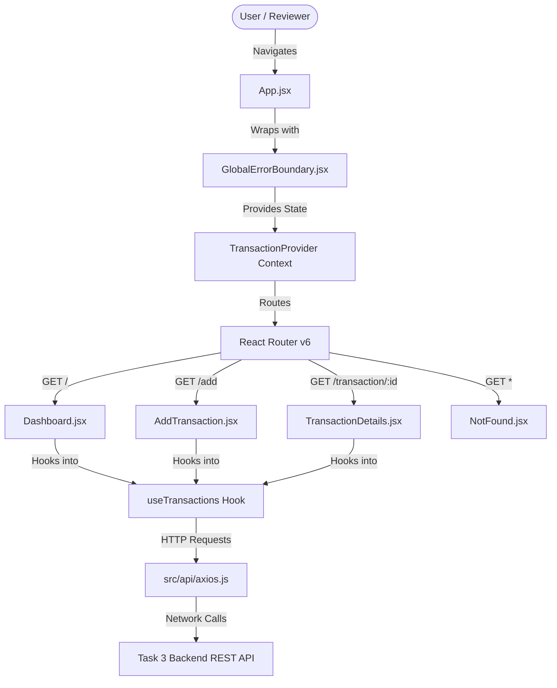

# Financial Transaction & Expense Tracker SPA

> **YR NOVATECH Task 5: Advanced Frontend & API Integration**  
> A high-performance, responsive React Single-Page Application (SPA) built with **React 18**, **Vite**, **Tailwind CSS**, **React Router v6**, **Axios**, and **React Error Boundary**, integrated seamlessly with the Task 3 Financial Transaction REST API.

[](https://react.dev)
[](https://vitejs.dev)
[](https://tailwindcss.com)
[](https://reactrouter.com)
[](https://axios-http.com)
[](LICENSE)

---

## 📌 1. Project Overview

This repository contains the complete implementation for **YR NOVATECH Task 5: Advanced Frontend & API Integration**. It delivers a production-ready financial tracking web application that connects directly to the live backend REST API developed in Task 3 (`https://yr-novatech-rest-api.vercel.app/api`).

### 🌟 Key Architectural Highlights
- **Lightning-Fast Tooling (Vite + React)**: Zero-bundle ESM development server and optimized rollup production distribution.
- **Client-Side Routing (`react-router-dom` v6)**: Dynamic declarative routing with URL parameter extraction (`/transaction/:id`), nested layouts, and a dedicated 404 route.
- **Robust API Integration (Axios Interceptors)**: Standardized HTTP requests, environment variable base URL switching, dynamic timeout safeguards, and user-friendly error formatting.
- **Centralized State & Metrics (`useTransactions`)**: Custom React Context and hook providing reactive caching, optimistic deletions, and automated calculation of Net Balance, Total Income, and Total Expenses.
- **Resilient UI Architecture (`react-error-boundary`)**: Wraps component tree in an enterprise-grade error boundary that intercepts render exceptions and displays an aesthetic recovery fallback.
- **Strict Client-Side Validation**: Interactive form validation preventing empty submissions, constraining input ranges (2–150 characters, positive monetary values), and offering 1-click sample presets for rapid reviewer evaluation.
- **Vercel Deployment Compatibility**: Configured with `vercel.json` SPA rewrites to ensure direct route access and page reloads function flawlessly.

---

## 🏗️ 2. Frontend Architecture & Flow



---

## 🚀 3. Application Routes & Views

| Route | View Component | Description |
|-------|----------------|-------------|
| `/` | `Dashboard.jsx` | Financial metrics cards (Net Balance, Income, Expense, Count), category search, type filters, and live transactions ledger. |
| `/add` | `AddTransaction.jsx` | Transaction creation form with live client-side validation, error messages, and 1-click sample presets. |
| `/transaction/:id` | `TransactionDetails.jsx` | Dynamic details view showing formatted currency, category tags, UTC timestamps, raw JSON viewer, and delete option. |
| `*` | `NotFound.jsx` | Styled 404 fallback page for non-existent paths with quick navigation back to Dashboard. |

---

## 🔌 4. API Integration Details

### Axios Configuration (`src/api/axios.js`)
The API layer is centralized through an Axios client instance:
```javascript
import axios from 'axios';

const API_BASE_URL = import.meta.env.VITE_API_BASE_URL || 'https://yr-novatech-rest-api.vercel.app/api';

const apiClient = axios.create({
  baseURL: API_BASE_URL,
  headers: {
    'Content-Type': 'application/json',
    'Accept': 'application/json',
  },
  timeout: 10000,
});
```

### Environment Variables
- `VITE_API_BASE_URL`: Defines the target REST API URL.
- Configured in `.env` and `.env.example`:
  ```env
  VITE_API_BASE_URL=https://yr-novatech-rest-api.vercel.app/api
  ```

### Endpoints Consumed
- `GET /transactions` - Fetches all financial entries with optional `?type=` and `?category=` queries.
- `GET /transactions/:id` - Fetches an individual transaction record.
- `POST /transactions` - Submits a validated transaction payload (`title`, `amount`, `type`, `category`).
- `DELETE /transactions/:id` - Permanently removes a transaction record from the database.

---

## 🛡️ 5. Error Boundaries & Form Validation

### Global Error Boundary
Wrapped via `react-error-boundary` in `src/components/GlobalErrorBoundary.jsx`:
- Catches runtime rendering exceptions anywhere in the React tree.
- Prevents white-screen crashes.
- Displays a styled glassmorphism error card with the error message and an interactive "Try Again" recovery trigger.

### Client-Side Form Validation
In `src/pages/AddTransaction.jsx`:
- **Title**: Required, length 2 to 150 characters.
- **Amount**: Required, numeric, strictly greater than $0.00.
- **Type**: Must be `'income'` or `'expense'`.
- **Category**: Required, length 2 to 80 characters.
- Real-time inline feedback clears errors as the user modifies the inputs.

---

## 💻 6. Local Setup & Testing

### Prerequisites
- Node.js (v18.0.0 or higher)
- npm (v9.0.0 or higher)

### Installation
```bash
# Clone the repository
git clone https://github.com/Obraims/yr-novatech-frontend.git
cd yr-novatech-frontend

# Install dependencies
npm install

# Start local Vite development server
npm run dev
```

Open `http://localhost:5173` in your browser.

### Production Build & Preview
```bash
# Build production bundle to dist/
npm run build

# Preview production build locally
npm run preview
```

---

## 📂 7. Project Directory Structure

```
yr-novatech-frontend/
├── .env                      # Local environment configuration
├── .env.example              # Environment variable template
├── .gitignore                # Git ignore rules for node_modules and build artifacts
├── index.html                # Vite HTML template with Google Fonts
├── package.json              # Project manifest and npm scripts
├── postcss.config.js         # PostCSS configuration for Tailwind
├── README.md                 # Comprehensive project guide and documentation
├── tailwind.config.js        # Tailwind CSS scanning and custom dark theme
├── vercel.json               # Vercel SPA client-side routing rewrites
└── src/
    ├── App.jsx               # Root router, layout, and ErrorBoundary wrapper
    ├── index.css             # Tailwind directives and custom scrollbar styles
    ├── main.jsx              # React DOM render entry point
    ├── api/
    │   └── axios.js          # Configured Axios instance with interceptors
    ├── components/
    │   ├── GlobalErrorBoundary.jsx # react-error-boundary UI crash protector
    │   └── Navbar.jsx        # Navigation header with active route styling
    ├── hooks/
    │   └── useTransactions.jsx # Centralized Context & hook for financial records
    └── pages/
        ├── AddTransaction.jsx     # Form view with client-side validation
        ├── Dashboard.jsx          # Analytics metrics and transaction ledger
        ├── NotFound.jsx           # 404 unmatched route handler
        └── TransactionDetails.jsx # Individual transaction details view
```

---

## 👤 8. Author & Evaluation Metadata

- **Developer**: Stephen Baraka Kakui
- **GitHub**: [@Obraims](https://github.com/Obraims)
- **Email**: [stephenbaraka9283@gmail.com](mailto:stephenbaraka9283@gmail.com)
- **Role**: Full-Stack Software Engineer & FinTech Innovator
- **Evaluation**: YR NOVATECH Task 5: Advanced Frontend & API Integration
